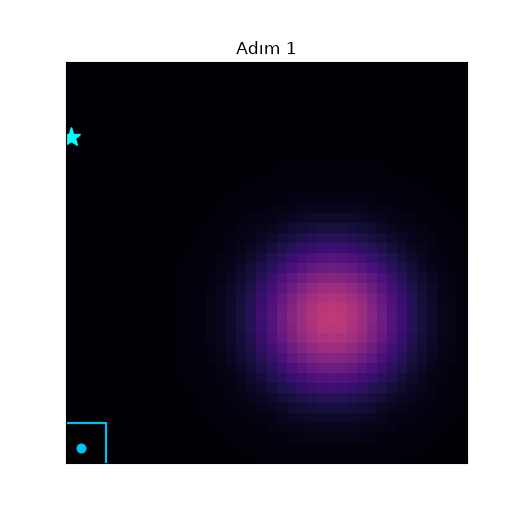
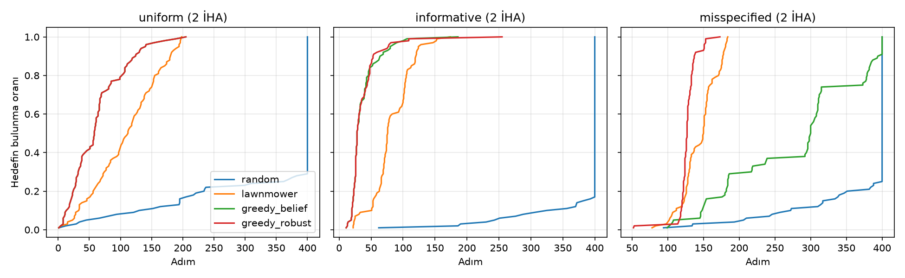
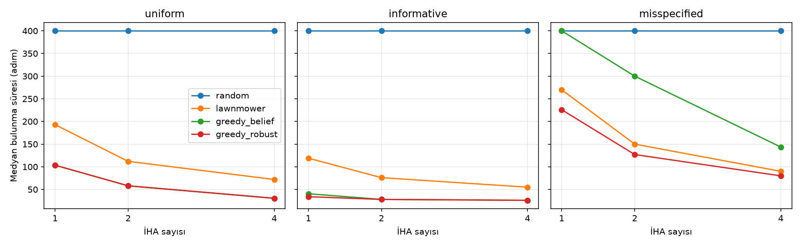

# UAV Search Planner: Çoklu İHA ile Bayesçi Arama

Kayıp bir kişiyi, aracı veya ilgi nesnesini **tam yeri bilinmeden** arayan çoklu İHA'lar için
planlayıcı simülasyonu. Arama-kurtarma (SAR), sınır/çevre gözetleme ve keşif-gözetleme (ISR)
görevlerinin ortak problemidir: sınırlı sensör ömrüyle, belirsiz bir önsel bilgiyle, mümkün olan en
kısa sürede hedefi bulmak. Proje tamamen savunmacı ve sivil güvenlik amaçlı arama planlamasına odaklanır.



*Yanlış önselle başlayan 2 İHA'lık arama. Parlak bölge planlayıcının olasılık haritası (belief), yeşil/mavi
kareler kamera izleri, camgöbeği yıldız gerçek hedef. İHA'lar önce önsele güvenip orayı tarıyor, orada
bulamayınca belief güncellenip aramayı doğru bölgeye yayıyor.*

## Model
- **Alan:** 40 x 40 hücre, tek ve sabit hedef. Başlangıçta herkes aynı üsten (sol alt köşe) kalkar.
- **Sensör:** İHA'nın bulunduğu hücre merkezli 5 x 5 kamera izi, izin içinde hedefi görme olasılığı `p_d = 0.9`
  (kaçırma olasılığı %10, yanlış alarm yok).
- **Belief:** Her hücre için "hedef burada" olasılığı. Bulunamayınca taranan hücrelerin olasılığı
  `(1 - p_d)` ile çarpılıp yeniden normalize edilir (Bayes kuralı, `world.py`).

## Stratejiler
| Strateji | Fikir |
|---|---|
| `random` | Rastgele yürüyüş (taban çizgisi) |
| `lawnmower` | Alanı İHA sayısı kadar şeride böler, her biri kendi şeridini satır satır tarar; bitince başa döner |
| `greedy_belief` | Her İHA, kamera izindeki olasılık kütlesi / (mesafe + 1) skorunu en yüksek hücreye gider; çok İHA'da seçilen hücrenin izi geçici silinerek yığılma önlenir |
| `greedy_robust` | `greedy_belief` ile aynı, ama başlangıç belief'ine %20 düzgün dağılım karıştırır (önsele sınırlı güven) |

## Senaryolar
- **uniform:** Önsel bilgi yok.
- **informative:** Önsel doğru (hedef, planlayıcının bildiği son bilinen konum çevresinden gelir).
- **misspecified:** Önsel **yanlış**: hedef, planlayıcının bildiğinden ~23 hücre uzakta bir bölgeden gelir.

## Sonuçlar (2 İHA, 100 bölüm, en çok 400 adım)
Medyan bulunma süresi (bulunamayan bölüm 400 sayılır) ve 400 adımda bulunma oranı:

| Senaryo | random | lawnmower | greedy_belief | greedy_robust |
|---|---|---|---|---|
| uniform | 400 (%28) | 112 (%100) | **58** (%100) | **58** (%100) |
| informative | 400 (%16) | 76 (%100) | **28** (%100) | **28** (%100) |
| misspecified | 400 (%24) | 150 (%100) | 300 (**%90**) | **127** (%100) |




Tüm sayılar `results/benchmark.csv` içinde (1, 2 ve 4 İHA).

**Bulgular**
1. Önsel doğruyken ya da hiç yokken belief tabanlı planlama, tarama desenine göre medyan süreyi yaklaşık yarıdan fazla düşürüyor
   (informative: 76 → 28 adım).
2. Önsel yanlışken saf `greedy_belief` en kötü iki stratejiden biri: planlayıcı kendi önseline fazla güvenip uzak bölgeleri
   geç ziyaret ediyor, 400 adımda hedefi bulma oranı %90'a düşüyor ve medyan süre tarama desenininkinin iki katı.
3. Önsele %20 düzgün dağılım karıştırmak (`greedy_robust`) bu çöküşü düzeltiyor: yanlış önselde bile tarama desenini geçiyor
   (127 vs 150 adım), doğru önselde ise saf versiyonla aynı sonucu veriyor. Bu karışım oranını (0.2) elle seçtim, ayarlanmış değil.

## Çalıştırma
```bash
pip install -r requirements.txt
python -m pytest -q              # 7 test
python src/run_benchmark.py      # ~1 dakika, results/ altına tablo ve grafikleri yazar
python src/animate.py            # GIF üretir
```
Rastgelelik sabit tohumlarla yönetiliyor, ama NumPy sürümleri arasında küçük sapmalar olabilir; kendi çalıştırmandaki sayıları kullan.

## Sınırlılıklar
- 2 boyutlu ızgara, sabit tek hedef, kare kamera izi; rüzgar, enerji/batarya, irtifa, iletişim kesintisi ve engel/arazi yok
- Yanlış alarm modellenmedi; gerçek sensörlerde belief güncellemesi buna da dayanmalı
- Açgözlü planlayıcı tek adımlı (ileriyi planlamıyor); `greedy_robust`'taki karışım oranı ayarlanmadı
- Bu bir simülasyon çalışmasıdır, gerçek bir görev sistemi değildir

## Sonraki adımlar
- ROS 2 + Gazebo'ya taşımak (gerçek dinamik ve sensör gecikmesi)
- Yanlış alarm ve çoklu hedef ekleme, ileri planlayan (rollout/MCTS) planlayıcı
- Belief güncellemesini gerçek bir hava görüntüsü dedektörünün çıktısına bağlamak
